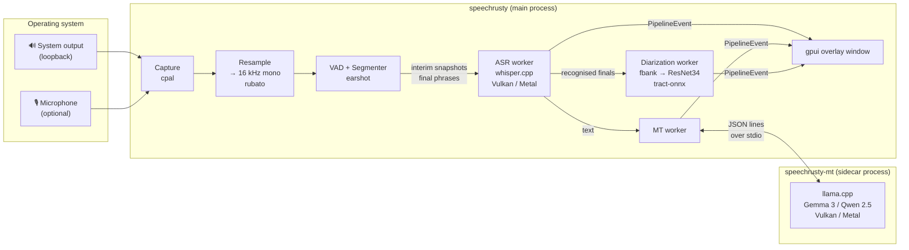
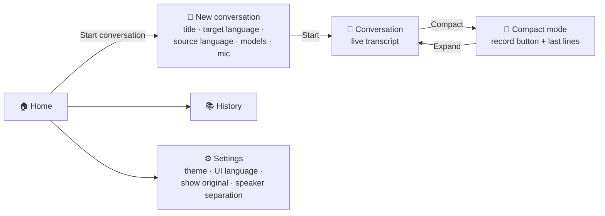
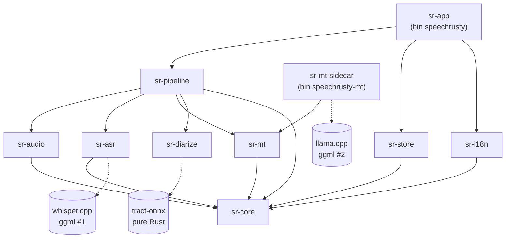

<div align="center">

# SpeechRusty

**Live, on-device speech translation for calls and videos, written entirely in Rust.**

An always-on-top, semi-transparent subtitle window that listens to your system audio (and, optionally, your microphone), recognises speech with Whisper, translates it with a local LLM, and tells the speakers apart. Nothing ever leaves your machine.


</div>

---

## Contents

- [Features](#features)
- [How it works](#how-it-works)
- [Languages and models](#languages-and-models)
- [Benchmarks](#benchmarks)
- [Getting started](#getting-started)
- [Using the app](#using-the-app)
- [Developer tools](#developer-tools)
- [Project layout](#project-layout)
- [Status and roadmap](#status-and-roadmap)
- [Known limitations](#known-limitations)

Deep dive: **[docs/ARCHITECTURE.md](docs/ARCHITECTURE.md)**: threads, queues, the segmenter state machine, echo suppression, diarization, the sidecar protocol and the design decisions behind them.

---

## Features

| | |
|---|---|
| 🎧 **System audio capture** | Translates whatever your computer plays: Zoom, Teams, Meet, YouTube. WASAPI loopback on Windows, Core Audio process tap on macOS 14.2+. |
| 🎙️ **Optional microphone** | Your own lines are labelled **"Me"**. If you use speakers instead of headphones, echo from the speakers into the microphone is detected and removed. |
| 🗣️ **Speaker separation** | Remote voices become *Speaker-1*, *Speaker-2*, …, each with its own colour. Click a name to rename it (for example to "Anna"). |
| ⚡ **Live captions** | Pale interim text appears while someone is speaking. It is refined into a final line after a pause, the same way live captions work in Meet or Teams. |
| 🌍 **20 translation directions** | EN, RU, DE, ES, FR, any to any. The source language is detected automatically or can be pinned. |
| 🧠 **Context-aware translation** | The previous lines are fed to the LLM, so pronouns, gender and terminology stay consistent. |
| 🖥️ **GPU first, CPU fallback** | Vulkan on Windows (NVIDIA, AMD and Intel, including iGPUs) and Metal on Apple Silicon. Everything also runs on the CPU. |
| 🪟 **Overlay window** | Frameless, always on top, draggable and resizable from highlighted corners. Background dimming is adjustable (50% by default). |
| 📌 **Compact mode** | Shows only the record button and the last few lines. |
| ⌨️ **Hotkeys** | `Ctrl+R` / `Cmd+R` toggles recording while the window is focused. `Ctrl+Shift+R` / `Cmd+Shift+R` works globally. A red indicator shows when recording is on. |
| ❗ **Honest errors** | Lines that could not be recognised are shown as *"Speech not recognized"* instead of hallucinated subtitles. |
| 🎨 **Light, dark and system themes** | |
| 🌐 **5 UI languages** | English, Deutsch, Français, Español, Русский. The default follows the OS locale. |
| 🔒 **100% local** | No cloud APIs. The internet is only needed once, to download models. |

## How it works



1. **Capture.** Each audio source (system loopback and microphone) runs in its own thread. Audio is downmixed and resampled to 16 kHz mono.
2. **Segmentation.** A streaming voice-activity detector cuts the audio into phrases. Every second of ongoing speech it emits a snapshot for *interim* recognition, and on a pause it emits the *final* phrase.
3. **Recognition.** Whisper transcribes the phrase. The encoder context is shrunk to the phrase length, which makes short phrases 5–30× faster. Language detection is restricted to the five supported languages, and a filter rejects typical Whisper hallucinations ("Thanks for watching!").
4. **Translation.** A local instruction-tuned LLM translates the phrase, using the last three translated lines as conversational context. It runs in a separate process because whisper.cpp and llama.cpp each statically link their own copy of `ggml`.
5. **Speakers.** For recognised remote phrases a voice embedding (WeSpeaker ResNet34) is computed and clustered online into *Speaker-N*. Microphone phrases are always *Me*. Phrases that are just speaker echo are detected and retracted.
6. **UI.** Every stage reports through one event stream. Lines are updated in place as they move from interim to final, then translated, then assigned a speaker.

## Languages and models

Speech and translation languages: **English, Русский, Deutsch, Español, Français**, all 20 directions. If the detected language equals the target language, the original is shown as is.

| Role | id | Model | File | Size | Notes |
|---|---|---|---|---|---|
| Speech recognition | `whisper-large-v3-turbo` ⭐ | Whisper large-v3-turbo, q5_0 | `ggml-large-v3-turbo-q5_0.bin` | 574 MB | Best accuracy; wants a discrete GPU or Apple Silicon |
| | `whisper-medium` | Whisper medium, q5_0 | `ggml-medium-q5_0.bin` | 539 MB | Middle ground |
| | `whisper-small` | Whisper small, q5_1 | `ggml-small-q5_1.bin` | 190 MB | Fastest; the best choice on integrated GPUs |
| Translation | `llm-fast` | Qwen2.5 1.5B Instruct, Q4_K_M | `qwen2.5-1.5b-instruct-q4_k_m.gguf` | 1.1 GB | Fastest; also translates interim text. Simpler wording, occasional mistakes |
| | `llm-4b` ⭐ | Gemma 3 4B it, Q4_K_M | `google_gemma-3-4b-it-Q4_K_M.gguf` | 2.5 GB | Natural, context-aware translation |
| | `llm-large` | Gemma 3 12B it, Q4_K_M | `google_gemma-3-12b-it-Q4_K_M.gguf` | 7.3 GB | Best quality; needs 8+ GB VRAM or a 16+ GB Mac |
| Speaker embeddings | n/a | WeSpeaker ResNet34-LM (VoxCeleb) | `voxceleb_resnet34_LM.onnx` | 26 MB | Runs on CPU in pure Rust (tract) |

⭐ = recommended default.

## Benchmarks

All numbers were measured on a deliberately modest laptop: **AMD Ryzen 7 5700U with integrated Radeon Vega 8 graphics (Vulkan), 40 GB RAM, Windows 11**, using release builds. A discrete GPU or Apple Silicon will be considerably faster.

### Speech recognition

Six TTS phrases of 1.4–8 s in English and Russian. **RTF** (real-time factor) is processing time divided by audio duration, so lower is better. The first (warm-up) run is excluded.

| Model | Device | Encoder context | RTF | Accuracy |
|---|---|---|---:|---|
| small q5_1 | Vulkan iGPU | phrase + 256 | **0.13** | 6/6 exact |
| small q5_1 | CPU, 8 threads | phrase + 256 | 0.45 | 6/6 exact |
| small q5_1 | CPU, 8 threads | full 30 s | 2.0 | 6/6 exact |
| large-v3-turbo q5_0 | Vulkan iGPU | phrase + 256 | 0.54 | repeats on short phrases (collapsed by the filter) |
| large-v3-turbo q5_0 | Vulkan iGPU | full 30 s | 12.8 | exact, but unusably slow |

> Shrinking Whisper's encoder context from the fixed 30 s window to *phrase length + 256 frames* is the single biggest speed-up: it is 4–24× faster with no loss of accuracy once the safety margin is in place.

### Translation

Eleven phrases over ten language directions.

| Model | Mean latency per phrase | Quality |
|---|---:|---|
| Qwen2.5 1.5B | ~1.0 s | Meaning preserved, some grammar errors and occasional distortions |
| Gemma 3 4B | ~2.3 s | 11/11 correct and natural; uses context (e.g. grammatical gender from the previous line) |

### End to end (in the app)

| Setup | Final text after the phrase ends | Translation after the final text |
|---|---:|---:|
| turbo + Gemma 4B, both on the iGPU | ~1.1 s | 2.7–3 s (up to 9–11 s while both models compete for the iGPU) |
| small + Gemma 4B | ~0.3 s | 2–3 s |

Other timings:

| Component | Time |
|---|---|
| Speaker embedding per phrase (CPU) | 0.2–1 s |
| Same-voice cosine similarity (TTS voices) | 0.63–0.91 |
| Different-voice cosine similarity | 0.31–0.53 |
| Model load + GPU warm-up (turbo) | ~13 s, once per session |

**Takeaway:** on a weak integrated GPU, pick `whisper-small` + `llm-4b`, because turbo and Gemma slow each other down on a shared iGPU. Turbo is meant for discrete GPUs and Apple Silicon.

## Getting started

> **Status:** pre-release. There are no prebuilt archives yet, and models are downloaded manually; an in-app model manager is on the [roadmap](#status-and-roadmap). Windows is the tested platform. The macOS code paths are written but not yet verified on a Mac.

### 1. Prerequisites

**Windows 11**

| Tool | Why | Install |
|---|---|---|
| Rust (stable, edition 2024) | everything | [rustup.rs](https://rustup.rs) |
| Visual Studio 2022+ with *Desktop development with C++* | MSVC toolchain for whisper.cpp / llama.cpp | Visual Studio Installer |
| CMake | builds whisper.cpp / llama.cpp | `winget install Kitware.CMake` |
| LLVM (libclang) | `bindgen` for the `-sys` crates | `winget install LLVM.LLVM` |
| Vulkan SDK | GPU backend for ggml | `winget install KhronosGroup.VulkanSDK` |

**macOS 14.2+ (Apple Silicon)**: Xcode command-line tools, CMake (`brew install cmake`) and Rust. Metal needs no SDK.

### 2. Configure the build

Copy the example cargo config and adjust the paths for your machine:

```powershell
copy .cargo\config.toml.example .cargo\config.toml
```

```toml
[build]
# Keep the target dir OUTSIDE OneDrive / Dropbox: sync locks PDB files and MSVC fails with C1041.
target-dir = "C:/dev/speechrusty-target"

[env]
LIBCLANG_PATH = "C:/Program Files/LLVM/bin"
VULKAN_SDK    = "C:/VulkanSDK/1.4.xxx.0"
CMAKE         = "C:/Program Files/CMake/bin/cmake.exe"
```

### 3. Build

On Windows always build through **`build.cmd`**. It enters the MSVC developer environment and makes CMake use NMake, because recent MSBuild versions break the `vulkan-shaders-gen` sub-project of ggml.

```powershell
.\build.cmd build --release -p sr-app -p sr-mt-sidecar
```

This produces two executables next to each other:

- `speechrusty.exe`: the app.
- `speechrusty-mt.exe`: the translation sidecar. The app looks for it next to its own executable, or at the path in `SR_MT_SIDECAR`.

On macOS, use plain `cargo build --release -p sr-app -p sr-mt-sidecar`.

### 4. Download models

Put the files into the models folder:

| OS | Models folder |
|---|---|
| Windows | `%APPDATA%\SpeechRusty\data\models\` |
| macOS | `~/Library/Application Support/SpeechRusty/models/` |

The recommended set for a laptop with an integrated GPU is about 2.7 GB:

```powershell
$m = "$env:APPDATA\SpeechRusty\data\models"; mkdir $m -Force | Out-Null
$hf = "https://huggingface.co"
curl.exe -L -o "$m\ggml-small-q5_1.bin"               "$hf/ggerganov/whisper.cpp/resolve/main/ggml-small-q5_1.bin"
curl.exe -L -o "$m\google_gemma-3-4b-it-Q4_K_M.gguf"  "$hf/bartowski/google_gemma-3-4b-it-GGUF/resolve/main/google_gemma-3-4b-it-Q4_K_M.gguf"
curl.exe -L -o "$m\voxceleb_resnet34_LM.onnx"         "$hf/Wespeaker/wespeaker-voxceleb-resnet34-LM/resolve/main/voxceleb_resnet34_LM.onnx"
```

<details>
<summary>All model URLs</summary>

| File | URL |
|---|---|
| `ggml-large-v3-turbo-q5_0.bin` | https://huggingface.co/ggerganov/whisper.cpp/resolve/main/ggml-large-v3-turbo-q5_0.bin |
| `ggml-medium-q5_0.bin` | https://huggingface.co/ggerganov/whisper.cpp/resolve/main/ggml-medium-q5_0.bin |
| `ggml-small-q5_1.bin` | https://huggingface.co/ggerganov/whisper.cpp/resolve/main/ggml-small-q5_1.bin |
| `qwen2.5-1.5b-instruct-q4_k_m.gguf` | https://huggingface.co/Qwen/Qwen2.5-1.5B-Instruct-GGUF/resolve/main/qwen2.5-1.5b-instruct-q4_k_m.gguf |
| `google_gemma-3-4b-it-Q4_K_M.gguf` | https://huggingface.co/bartowski/google_gemma-3-4b-it-GGUF/resolve/main/google_gemma-3-4b-it-Q4_K_M.gguf |
| `google_gemma-3-12b-it-Q4_K_M.gguf` | https://huggingface.co/bartowski/google_gemma-3-12b-it-GGUF/resolve/main/google_gemma-3-12b-it-Q4_K_M.gguf |
| `voxceleb_resnet34_LM.onnx` | https://huggingface.co/Wespeaker/wespeaker-voxceleb-resnet34-LM/resolve/main/voxceleb_resnet34_LM.onnx |

</details>

Missing models are not fatal. Without a translation model the app shows the original text with a *"Translation unavailable"* notice, and without the embedding model all remote speech is attributed to a single speaker.

### 5. Run

```powershell
.\build.cmd run --release -p sr-app
```

Settings are stored in `%APPDATA%\SpeechRusty\config\settings.toml` (Windows) and `~/Library/Application Support/SpeechRusty/settings.toml` (macOS).

## Using the app



| Action | How |
|---|---|
| Start or pause translation | `Ctrl+R` / `Cmd+R`, the record button, or globally `Ctrl+Shift+R` / `Cmd+Shift+R` |
| Move the window | Drag the header |
| Resize | Drag an edge or a highlighted corner |
| Dim the background | Slider in the footer (50% by default) |
| Rename a speaker | Click the speaker's name, type, then press Enter |
| Compact mode | Button in the header |
| Show or hide the original under the translation | Settings |

Each line looks like this:

```
● Speaker-1                               (colour per speaker)
  Hi everyone, can you hear me?            ← translation (bold)
  Привет всем, меня слышно?                ← original (small, grey; optional)
```

States: interim text is pale, a final line waiting for translation is dimmed and marked *"translating…"*, unrecognised speech is shown in red as *"Speech not recognized"*, and a failed translation is marked in yellow.

### Environment variables

| Variable | Effect |
|---|---|
| `SR_DEMO=1` | Plays a scripted demo conversation without any audio or models |
| `SR_DUMP_SEGMENTS=1` | Saves every detected phrase as a WAV file, for tuning the segmenter |
| `SR_ASR_CPU=1` | Forces Whisper onto the CPU |
| `SR_MT_CPU=1` | Forces the translation LLM onto the CPU |
| `SR_MT_SIDECAR=<path>` | Explicit path to `speechrusty-mt` |
| `SR_MT_DEBUG=1` | Sidecar prints prompts and raw generations to stderr |
| `RUST_LOG=debug` | More verbose logging (the default is `info`) |

## Developer tools

Every engine crate has a stand-alone example, so components can be benchmarked without the UI:

```powershell
# Whisper: RTF and output for a set of 16 kHz WAV files
.\build.cmd run -p sr-asr --release --example bench -- <model.bin> a.wav b.wav [--cpu] [--full-ctx] [--margin 256]

# Translation: 11 phrases over 10 directions, through the real sidecar
.\build.cmd run -p sr-mt --release --example mt_bench -- <model.gguf> [--cpu]

# Diarization: embeddings, pairwise similarities and cluster assignment for WAV files
.\build.cmd run -p sr-diarize --release --example voices -- voxceleb_resnet34_LM.onnx a.wav b.wav ...

# Full live pipeline in the terminal for N seconds (system audio, optional mic, ASR, MT, diarization)
.\build.cmd run -p sr-pipeline --release --example live -- 30 --model <ggml.bin> --mt <model.gguf> --diar <model.onnx> [--mic] [--dump <dir>]
```

Tests and lints:

```powershell
.\build.cmd test --workspace
.\build.cmd clippy --workspace --all-targets
```

The tests cover the segmenter (including real TTS speech mixed with noise), the resampler, the Whisper output filters, prompt building and output cleaning, the priority queue, speaker clustering, echo detection, text-similarity echo matching, settings round-trips and i18n completeness.

## Project layout

```
speechrusty/
├── crates/
│   ├── app/          speechrusty: gpui window, screens, hotkeys, topmost/platform glue
│   ├── core/         shared types: Lang, Speaker, Utterance, PipelineEvent, SessionConfig
│   ├── i18n/         UI strings in 5 languages (compile-time complete)
│   ├── store/        settings.toml, data paths, conversation files
│   ├── audio/        capture (cpal), resampling (rubato), VAD + segmenter (earshot)
│   ├── asr/          whisper.cpp engine, language detection, hallucination filter
│   ├── mt/           translation protocol, prompt builder, sidecar client
│   ├── mt-sidecar/   speechrusty-mt: llama.cpp host process
│   ├── diarize/      speaker embeddings, online clustering, echo detection
│   └── pipeline/     threads and queues that tie it all together
├── spikes/           early throw-away prototypes (window, audio, ML); not part of the workspace
├── docs/
│   ├── ARCHITECTURE.md
│   ├── PLAN.ru.md    working design spec and stage log (Russian)
│   └── spec.ru.md    original product brief (Russian)
└── build.cmd         Windows build wrapper (MSVC env + NMake)
```



## Status and roadmap

| # | Stage | Status |
|---|---|---|
| 0 | Technical spikes: transparent topmost window, loopback capture, whisper + llama on Vulkan | ✅ |
| 1 | UI shell: screens, themes, 5 UI languages, dimming, compact mode, hotkeys, saved geometry | ✅ |
| 2 | Audio capture, resampling, VAD, segmentation, level meters | ✅ |
| 3 | Whisper: interim and final text, language detection, "Speech not recognized" | ✅ |
| 4 | Translation via the llama.cpp sidecar, with context | ✅ |
| 5 | Diarization, echo suppression, speaker colours and renaming | ✅ |
| 6 | Conversation log files and the History screen | ⏳ |
| 7 | Hardware detection (VRAM/RAM), model tiers, in-app model downloads, first-run flow | ⏳ |
| 8 | Packaging: Windows zip, macOS `.app` zip with ad-hoc signing | ⏳ |

Everything up to stage 5 has been verified on Windows 11. macOS support (Metal, process tap, floating window level) is implemented behind `cfg(target_os = "macos")` but not yet tested.

## Known limitations

- **Language is detected per phrase.** If someone switches language mid-phrase without pausing, part of the phrase may be recognised in the wrong language.
- **One speaker per phrase.** If two people talk over each other without a pause, the whole phrase goes to one of them.
- **Similar voices may merge.** The clustering threshold (cosine 0.55) was tuned on TTS voices and still needs validation on real calls.
- **Shared iGPU contention.** Running large-v3-turbo and Gemma on the same integrated GPU noticeably delays translations; use `whisper-small` there.
- **No prompt KV cache.** Each translation re-evaluates the system prompt and context, which leaves some speed on the table.
- **macOS is untested.**
