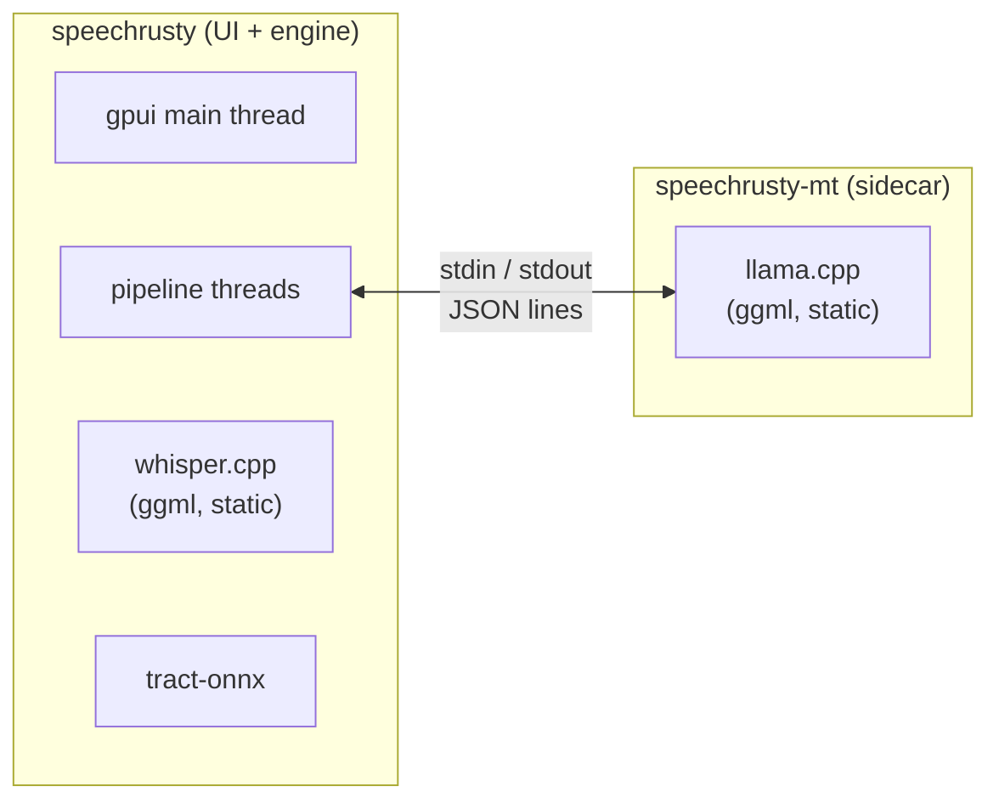
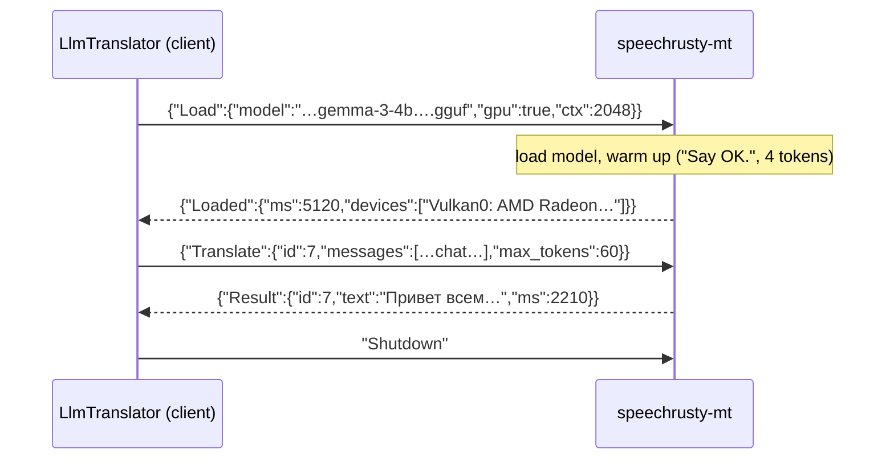
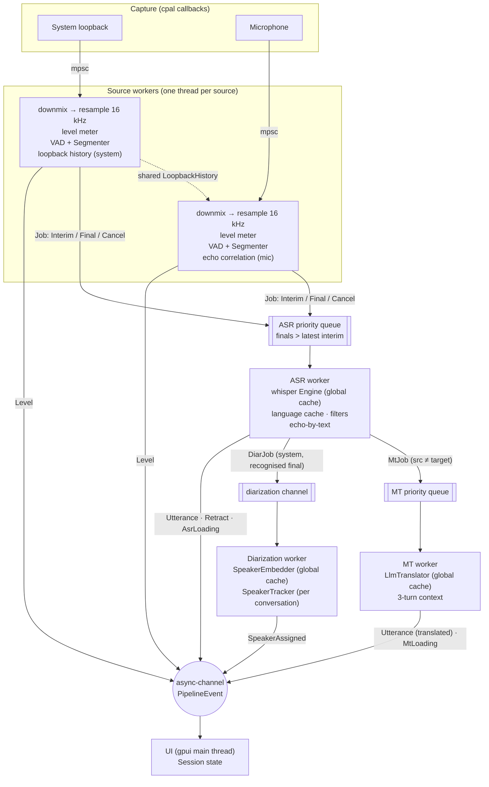
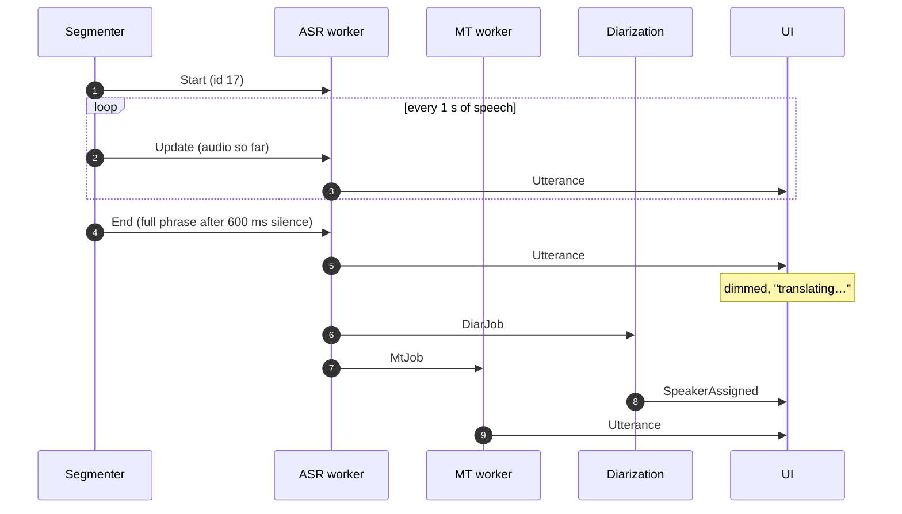
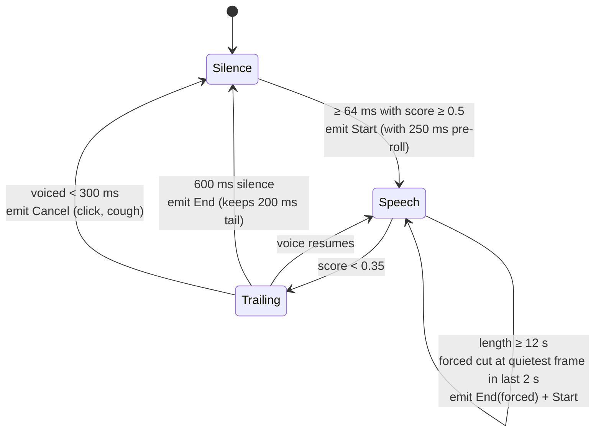
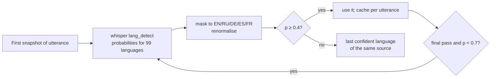
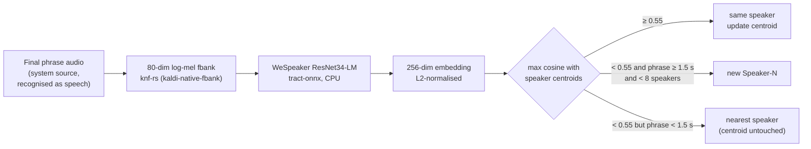
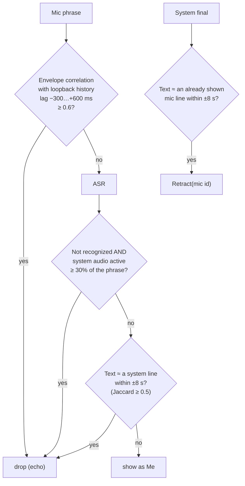

# SpeechRusty architecture

This document explains how SpeechRusty turns audio coming out of your speakers into translated, speaker-labelled subtitles. It covers the threads and queues involved, the algorithms, and why each design decision was made.

- [1. Goals and constraints](#1-goals-and-constraints)
- [2. Process model](#2-process-model)
- [3. Threads and data flow](#3-threads-and-data-flow)
- [4. Life of an utterance](#4-life-of-an-utterance)
- [5. Audio capture and resampling](#5-audio-capture-and-resampling)
- [6. VAD and segmentation](#6-vad-and-segmentation)
- [7. Speech recognition](#7-speech-recognition)
- [8. Translation](#8-translation)
- [9. Speaker diarization](#9-speaker-diarization)
- [10. Echo suppression](#10-echo-suppression)
- [11. Priority queues and backpressure](#11-priority-queues-and-backpressure)
- [12. Pipeline events and UI state](#12-pipeline-events-and-ui-state)
- [13. The overlay window](#13-the-overlay-window)
- [14. Storage and settings](#14-storage-and-settings)
- [15. GPU strategy](#15-gpu-strategy)
- [16. Build system notes](#16-build-system-notes)
- [17. Decision log](#17-decision-log)

---

## 1. Goals and constraints

| Goal | Consequence |
|---|---|
| **Fully local**: no cloud, no telemetry | Whisper and an LLM run on the user's own hardware, so every millisecond counts. |
| **Rust only**: UI and engine | The UI uses gpui. Models run through whisper.cpp and llama.cpp via Rust bindings, and ONNX through tract, which is pure Rust. |
| **Live**: text should appear while people speak | Interim and final passes, a priority queue, and Whisper's encoder context shrunk to the phrase length. |
| **Any GPU** on Windows | Vulkan, which covers NVIDIA, AMD and Intel, iGPUs included. Metal on macOS. Everything falls back to the CPU. |
| **Robust on modest hardware** | Tuned and benchmarked on a Ryzen 7 5700U with a Vega 8 iGPU. |
| **Never show garbage** | Hallucination filters, "Speech not recognized" lines, echo retraction, and banning CJK tokens in the LLM output. |

## 2. Process model



There are **two processes**. `whisper-rs-sys` and `llama-cpp-2-sys` both statically link their own copy of `ggml`, so linking them into one binary fails with duplicate symbols (`LNK2005`). Moving llama.cpp into a sidecar fixed that and brought two more benefits:

- If the LLM crashes, for example because the driver runs out of VRAM, the UI survives. The client restarts the sidecar once and then marks lines as *translation failed*.
- Switching translation models frees all of the old model's memory, because the process simply exits.

On Windows the sidecar is spawned with `CREATE_NO_WINDOW`, so no console window flashes up.

### Sidecar protocol

Each message is one JSON object per line ([`crates/mt/src/protocol.rs`](../crates/mt/src/protocol.rs)):



Errors come back as `{"Error":{"id":7,"message":"…"}}`. An `id` of `null` means a fatal error, such as a failed load.

## 3. Threads and data flow



Key properties:

- **No blocking on the audio thread.** cpal callbacks only copy samples into an `mpsc` channel. Everything else happens in the source worker.
- **Sources are independent.** The system and microphone sources each have their own VAD and segmenter, so a remote speaker and the user can talk at the same time.
- **Engines are cached globally** (`ENGINE`, `TRANSLATOR` and `EMBEDDER` statics). Pausing and resuming recording does not reload anything. A different model id triggers a reload.
- **Ids are partitioned per recording run** (`run × 1 000 000`). A worker still finishing an old run in the background can never collide with lines from a new run.
- **Stopping is non-blocking.** `PipelineHandle::stop` stops the capture and source threads and closes the ASR queue. The ASR, MT and diarization workers finish the finals already queued in the background, so the last phrase is still translated, and the UI never waits on them.

## 4. Life of an utterance



The UI merges these events by id:

- A **final is never downgraded** by a late interim.
- A **speaker override** from diarization persists over any later update of the same line.
- A **retracted** id (echo or noise) is remembered and can't come back.

## 5. Audio capture and resampling

[`crates/audio/src/capture.rs`](../crates/audio/src/capture.rs)

| Platform | System audio | Microphone |
|---|---|---|
| Windows | cpal 0.18: `build_input_stream` on the default **output** device (WASAPI loopback) | cpal default input |
| macOS 14.2+ | cpal 0.18 Core Audio process tap (an aggregate device), which needs `NSAudioCaptureUsageDescription` | cpal default input, which needs `NSMicrophoneUsageDescription` |

- **Reconnection.** A watchdog checks the default device every 2 s and reopens the stream when it changes, for example when headphones are plugged in. A fatal stream error also triggers a reopen. "Buffer underrun/overrun" errors at stream start are harmless and are only logged.
- **Format.** Audio is downmixed to mono, then resampled to 16 kHz with `rubato::FftFixedInOut` (a passthrough if the device already runs at 16 kHz).
- **Time base.** Timestamps are computed from sample counts, not wall clocks, so they don't drift when a thread stalls.

## 6. VAD and segmentation

[`crates/audio/src/segment.rs`](../crates/audio/src/segment.rs)

The VAD is [earshot](https://crates.io/crates/earshot): pure Rust, with no model files, scoring 256-sample (16 ms) frames. Silero was dropped because whisper.cpp's built-in VAD works on whole buffers, not streams, and adding ONNX runtime just for a VAD wasn't worth it.



| Parameter | Value | Why |
|---|---|---|
| Start | 64 ms of confident speech | Ignores clicks but still catches a short "yes" |
| Pre-roll | 250 ms | Whisper needs the onset of the first syllable |
| End | 600 ms of silence | Natural pause between sentences |
| Tail | 200 ms | Prevents truncated final consonants |
| Max length | 12 s, cut at the quietest frame | Keeps latency bounded during monologues |
| Min voiced | 300 ms, counting **voiced** frames only (not the pre-roll) | Drops coughs and keyboard clicks |
| Interim cadence | every 1 s of speech, never during silence | Avoids re-transcribing the same audio during pauses |

## 7. Speech recognition

[`crates/asr`](../crates/asr) wraps `whisper-rs` 0.16, built with the `vulkan` feature on Windows and `metal` on macOS.

### Decoding parameters

These were chosen by benchmark (see the README):

- Greedy decoding, `no_context`, `single_segment`, `suppress_nst`.
- **`audio_ctx` = phrase frames + 256.** Whisper always pads input to 30 s, so a 2 s phrase normally costs as much as 30 s of audio. Shrinking the encoder context to the phrase length is 4–24× faster. Without the 256-frame (~5 s) margin, `small` truncated the ends of phrases and `turbo` repeated them.
- **flash-attention off.** On Vulkan, combined with the reduced context, it corrupts the output.
- **`max_tokens` = 8 per second of audio + 8.** This stops runaway loops early.
- **Temperature fallback (`temperature_inc` 0.2)** only on the final pass. Interim passes must be cheap.
- **Warm-up** right after loading. The first GPU run compiles shaders, which takes 4–30 s, and that should not happen on the user's first sentence.

### Language detection



Language detection is a separate encoder pass (about 1 s on an iGPU), so it runs once per utterance and interim passes reuse the result. If the user pins a source language, detection is skipped entirely.

### "Speech not recognized"

[`crates/asr/src/filter.rs`](../crates/asr/src/filter.rs) judges every transcript. A transcript is rejected when any of these holds:

- the text is empty;
- it is a known subtitle hallucination ("Thanks for watching!", "Untertitel im Auftrag des ZDF", "Продолжение следует…" and so on);
- it is a runaway repetition, i.e. the same n-gram repeated many times;
- `no_speech_prob` > 0.6 **and** `avg_logprob` < −0.8;
- `avg_logprob` < −1.2.

A rejected **final** becomes a red *"Speech not recognized"* line. A rejected **interim** is silently skipped. Duplicates such as "Hello. Hello.", which turbo sometimes produces on short phrases, are collapsed (`collapse_repeats`).

## 8. Translation

### Models

All three translation options are instruction-tuned LLMs in GGUF format, run by llama.cpp in the sidecar. One model covers all 20 directions.

Opus-MT/Marian was considered and rejected:

- It needs one model per direction.
- Several pairs, such as ES↔FR and DE↔RU, would have to pivot through English.
- The tokenizers would need converting.
- Candle has no Vulkan backend, so there would be no Windows GPU.

### Prompt

[`crates/mt/src/prompt.rs`](../crates/mt/src/prompt.rs)

```
system:    You are a professional simultaneous interpreter. Translate each user message from English
           to Russian. Messages are transcripts of live speech… Keep names, numbers and terms, and keep
           questions as questions. Reply with the Russian translation of the latest message only: …
user:      <previous original 1>          ┐
assistant: <previous translation 1>       │ up to 3 context turns
user:      <previous original 2>          │ (same conversation, any speaker)
assistant: <previous translation 2>       ┘
user:      <current phrase>
```

The context is given as real chat turns. When it was placed inside the system message, Gemma merged it into the current phrase and translated the context as well. Questions kept being turned into statements until the system message explicitly said *"keep questions as questions"*.

### Generation

[`crates/mt-sidecar/src/main.rs`](../crates/mt-sidecar/src/main.rs)

- The prompt is built with the model's own chat template (`llama_chat_apply_template`).
- **BOS.** Gemma's template does not insert `<bos>`. Without it Gemma 3 returns empty output or garbage, so the sidecar prepends BOS whenever the vocabulary requires it and the prompt does not already start with it.
- The sampler is `logit_bias → greedy`.
- **Banned tokens.** At load time every vocabulary piece is scanned, and tokens containing CJK, kana, hangul, emoji or full-width forms get a logit bias of −∞. That is about 30 000 tokens; without the ban Qwen leaks Chinese words into European-language translations.
- `max_tokens` = input length in characters (clamped to 16–400) + 32 (`max_tokens_for`).
- **Output cleaning** (`clean_output`) strips quotes, "Translation:" prefixes, and any explanation after a blank line.

### Scheduling

- Finals are always translated. **Interims are translated only with `llm-fast`** and only when they have at least 3 words. A 4B model on a weak GPU can't keep up with interim translation, and trying steals GPU time from Whisper.
- If a final for the same utterance is already queued, its interim job is dropped.
- If the source language equals the target language, no MT job is created and the original is shown.

## 9. Speaker diarization

[`crates/diarize`](../crates/diarize)



- **Only recognised finals are embedded.** Sending every segment to diarization let music, laughter and clicks create phantom speakers. The ASR worker now forwards only system-source finals whose outcome is `Text`.
- **Provisional speaker.** A new line is shown immediately with the *last* remote speaker. When the embedding finishes (0.2–1 s on the CPU), a `SpeakerAssigned` event corrects it if needed.
- **The tracker lives for the whole conversation.** The UI session owns `Arc<Mutex<SpeakerTracker>>` and passes it to each recording run, so Speaker-2 stays Speaker-2 after a pause.
- The **microphone is always "Me"** and is never clustered.
- tract was chosen over onnxruntime to avoid shipping a native DLL. The model is optimised and planned once (`TypedRunnableModel`) and then shared.

On TTS voices, same-voice similarity was 0.63–0.91 and different-voice similarity 0.31–0.53. All test phrases were assigned correctly, including a Russian voice speaking English and phrases played through speakers.

## 10. Echo suppression

When the user turns on the microphone without headphones, the mic hears the remote speakers. Without countermeasures every remote line would appear twice: once as *Speaker-N* and once as *Me*.

Correlating loudness envelopes alone turned out not to be enough. Synthetic own-speech scored up to 0.48, while a real quiet echo scored 0.42. So three signals are combined:



1. **Envelope correlation** ([`echo.rs`](../crates/diarize/src/echo.rs)). The system source records a 10 ms log-RMS envelope covering the last 60 s in a shared `LoopbackHistory`. The mic phrase's envelope is cross-correlated against it (Pearson) over lags from −300 to +600 ms. It only decides on its own at ≥ 0.6, which is a confident echo.
2. **Unintelligible mic audio while the speakers were playing** is dropped. That is what an echo looks like to Whisper.
3. **Text similarity is symmetric.** Whichever of the two arrives first, if a mic line and a system line within ±8 s share at least 50% of their words (Jaccard over lower-cased words), the mic line is removed. If it is already on screen, the ASR worker sends a `Retract(id)`, and the UI remembers the id so late updates can't revive it.

## 11. Priority queues and backpressure

[`crates/pipeline/src/queue.rs`](../crates/pipeline/src/queue.rs)

The ASR and MT workers share one generic `PriorityQueue<T: QueueItem>`:

- **Finals are processed first**, in FIFO order.
- **Only the latest interim per utterance is kept.** A new snapshot replaces the queued one, because transcribing a stale snapshot is wasted GPU time.
- `has_final_for(utt)` lets the MT worker skip an interim when the final is already waiting.
- `close()` lets workers drain their remaining finals and then exit.

Under load, interim text gets less frequent but finals are never lost.

## 12. Pipeline events and UI state

[`crates/core/src/lib.rs`](../crates/core/src/lib.rs)

```rust
pub enum PipelineEvent {
    Started, Stopped,
    Utterance(Utterance),                 // insert or update by id
    Level { source, level, speech },      // level meters
    Retract(u64),                         // remove a line (echo, noise)
    SpeakerAssigned { id, speaker },      // diarization result
    AsrLoading(bool), MtLoading(bool),    // banners while models load
    Notice(String), Failed(String),
}

pub struct Utterance {
    pub id: u64, pub speaker: Speaker, pub start_ms: u64,
    pub src_lang: Option<Lang>, pub dst_lang: Lang,
    pub original: String, pub translation: Option<String>,
    pub status: UtteranceStatus,          // Interim | Final | NotRecognized | TranslationFailed(msg)
}
```

The UI `Session` keeps these collections:

- `utterances` plus an `index: id → position`;
- `speakers: id → Speaker` overrides;
- `names: Speaker → String` from renames;
- the `retracted` id set;
- the conversation's `SpeakerTracker`.

Events arrive on an `async-channel` and are consumed by a gpui foreground task. Each recording run's task is kept alive until its channel closes, so the background drain of a previous run still reaches the screen.

## 13. The overlay window

[`crates/app`](../crates/app) uses **gpui** through `gpui-kit` 0.10, which bundles `gpui-pre` and `gpui-component`.

| Requirement | Implementation |
|---|---|
| Transparent background | `WindowBackgroundAppearance::Transparent`. gpui-kit's `Root` paints the theme background, so `Theme.background` and `tokens.background` are set to transparent and the app paints its own dimmed panels. |
| Dimming slider | Only the conversation screen uses the user's opacity. Each line, the header and the footer get their own plate at `opacity + 35%` (max 92%), like live captions, so text stays readable over any content. Forms and settings use at least 92%. |
| Always on top | Windows: `SetWindowPos(HWND_TOPMOST)` via `raw-window-handle`. macOS: `WindowKind::Floating`. |
| Move | `.window_control_area(Drag)` on the header (native `HTCAPTION`). Header buttons need `.occlude()`, or Windows routes their clicks to the drag area. |
| Resize | Native frame hit-testing. The corners are drawn as accent-coloured L-marks. |
| Hotkeys | `Ctrl/Cmd+R` is a gpui `KeyBinding` that only works while focused. `Ctrl/Cmd+Shift+R` is a system-wide hotkey via the `global-hotkey` crate. A global `Cmd+R` would steal "reload" from every browser. |
| Geometry persistence | `window.window_bounds()`. Plain `bounds()` drifted by 3 px per launch on a frameless window. |
| Themes | Light, dark and system palettes with 8 speaker colours that contrast in both themes. Accent is indigo; recording is red. |
| i18n | `sr-i18n`: one `keys!` macro table, with each key holding `[en, de, fr, es, ru]`. A missing translation is a compile error. |

## 14. Storage and settings

[`crates/store`](../crates/store) uses `directories::ProjectDirs` for the platform paths:

| | Windows | macOS |
|---|---|---|
| Settings | `%APPDATA%\SpeechRusty\config\settings.toml` | `~/Library/Application Support/SpeechRusty/settings.toml` |
| Models | `%APPDATA%\SpeechRusty\data\models\` | `~/Library/Application Support/SpeechRusty/models/` |
| Conversations | `%APPDATA%\SpeechRusty\data\conversations\` | `~/Library/Application Support/SpeechRusty/conversations/` |

Settings are written atomically (write to `.tmp`, then rename) and *sanitised* on load: a non-finite or out-of-range opacity is clamped, and implausible window geometry is discarded. Saves are debounced.

Planned conversation log format (stage 6). It is compact, human-readable and easy to parse:

```
# SpeechRusty | 2026-11-23 14:30 | "Partner call" | target=ru | asr=large-v3-turbo | mt=gemma3-4b
[00:00:12] Speaker-1 en→ru | Привет, всех слышно? || Hi, can everyone hear me?
[00:00:15] Me ru | Да, отлично слышно.
[00:00:21] Speaker-2 de→ru | ! speech not recognized
# renamed Speaker-1 = Anna
```

## 15. GPU strategy

- **One backend family everywhere: ggml.** whisper.cpp and llama.cpp both use ggml's Vulkan backend on Windows and Metal on macOS. Vulkan covers NVIDIA, AMD and Intel (including iGPUs) without CUDA or ROCm.
- **CPU fallback.** If GPU initialisation fails, or `SR_ASR_CPU` / `SR_MT_CPU` is set, the CPU is used.
- **The GPU is not always faster.** On a Vega 8 iGPU, Whisper *base* ran faster on the CPU (RTF 0.18) than on Vulkan (RTF 0.29). *small* was the other way round (0.13 on the GPU vs 0.45 on the CPU). The planned hardware-detection stage therefore chooses backends from a **measured** warm-up, not just from whether a GPU exists.
- **Planned (stage 7).** Query devices and free VRAM through ggml itself (`VK_EXT_memory_budget` on Vulkan, `recommendedMaxWorkingSetSize` on Metal), classify the machine into tiers (High: 8 GB+ free VRAM or a 16 GB Mac; Mid: 4 GB+; Low: CPU or iGPU), and label each model in the picker as "fits", "tight" or "won't fit".

## 16. Build system notes

| Problem | Fix |
|---|---|
| whisper and llama ggml symbols clash (`LNK2005`) | llama.cpp runs in the `speechrusty-mt` sidecar |
| MSBuild from recent VS breaks ggml's `vulkan-shaders-gen` ExternalProject | `build.cmd` enters `vcvars64` and sets `CMAKE_GENERATOR=NMake Makefiles` |
| `C1041` (PDB locked) when the target dir is inside OneDrive | `target-dir` outside synced folders (`.cargo/config.toml`) |
| A binary named `mt.exe` in the target dir shadowed the Windows SDK manifest tool, because cargo puts the target dir on `PATH` for build scripts | Never name workspace binaries after system tools. Spikes are named `spike-*`. |
| `knf-rs-sys` builds its C++ in Debug (`/MDd`) under `debug_assertions`, which mismatches Rust's `/MD` | `[profile.dev.package.knf-rs-sys] debug-assertions = false`. A global `build-override` would break gpui's proc-macros. |
| Heavy native crates make debug builds unusably slow | `[profile.dev.package."*"] opt-level = 2` |

## 17. Decision log

| Decision | Alternatives considered | Reason |
|---|---|---|
| gpui for the UI | egui, iced, Tauri | Native GPU rendering, real transparency, Rust-only, and a polished component kit |
| whisper.cpp via whisper-rs | candle Whisper, ONNX | Mature, quantised models, Vulkan and Metal |
| LLM for MT instead of Opus-MT | Marian / Opus-MT via candle | One model for all 20 directions, context-aware, runs on the same GPU stack |
| Separate MT process | Dynamic linking, a patched ggml | Linking conflict. Also isolates crashes and frees memory cleanly. |
| earshot VAD | Silero (ONNX), whisper.cpp VAD | Streaming, pure Rust, no model file |
| tract for embeddings | onnxruntime (`ort`) | Pure Rust, no DLL to ship |
| Per-phrase clustering | Frame-level diarization (pyannote-style) | Cheap and online. The limitation (one speaker per phrase) is acceptable for calls. |
| Text-based echo retraction | AEC (WebRTC APM) | AEC needs a sample-accurate reference; the loopback and mic clocks differ. Text matching is robust to that. |
